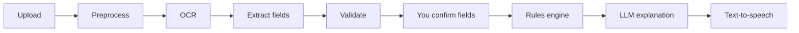

# Satbara Saathi (सातबारा साथी)

**Understand your Maharashtra 7/12 (Satbara) extract in plain Marathi, Hindi, or English.**

Upload a photo or scan of a 7/12. Satbara Saathi reads it, flags things worth a closer look, explains everything in simple language, and can read the summary aloud.

---

## Table of contents

1. [Why this exists](#why-this-exists)
2. [Who it is for](#who-it-is-for)
3. [What it does and does not do](#what-it-does-and-does-not-do)
4. [How it works](#how-it-works)
5. [Why the rules engine has no AI](#why-the-rules-engine-has-no-ai)
6. [A quick 7/12 glossary](#a-quick-712-glossary)
7. [Quick start](#quick-start)
8. [Configuration](#configuration)
9. [Project structure](#project-structure)
10. [Testing and evaluation](#testing-and-evaluation)
11. [Privacy](#privacy)
12. [Limitations](#limitations)

---

## Why this exists

The 7/12 extract (*Satbara Utara*) is the core land record in Maharashtra. It combines ownership details (Form VII) with cultivation details (Form XII). It is written in dense, technical Marathi, with codes, abbreviations, and legal terms that most farmers and first-time land buyers find hard to interpret.

Misreading it can mean missing a loan recorded against the land, a shared ownership entry, or an area that does not match what a seller claims. Satbara Saathi's goal is simple: **help people understand what their document says, so they can ask better questions before making decisions.**

## Who it is for

- **Farmers and landowners** who want to understand their own record.
- **Prospective buyers** doing a first-pass check before paying a lawyer.
- **Family members** helping elders read land documents.
- **Anyone who finds reading Marathi legal text difficult**, since the app can speak its summary aloud.

## What it does and does not do

### What it does

| Step | Description |
|---|---|
| 1. Reads | Accepts a 7/12 image (scanned or digital) |
| 2. Extracts | Uses OCR to pull out structured fields such as survey number, owners, and area |
| 3. Confirms | Lets you review and correct extracted fields before anything is analysed |
| 4. Checks | Runs deterministic red-flag rules on the confirmed data |
| 5. Explains | Uses an LLM to describe the findings in plain language |
| 6. Speaks | Reads the summary aloud with text-to-speech |
| 7. Answers | Supports follow-up questions in your chosen language |

### What it does NOT do

- ❌ Give legal advice
- ❌ Decide whether land is "safe" to buy
- ❌ Store your images or personal data
- ❌ Process 8A extracts, mutation extracts, or records from other states (yet)

## How it works



Each stage in plain terms:

1. **Upload.** You agree to a consent notice first. Nothing is processed before that.
2. **Preprocess.** The image is cleaned up (rotation, contrast, noise) so OCR reads it better.
3. **OCR.** Text is recognised from the image, including Marathi script.
4. **Extract.** Raw text is organised into structured fields, such as survey number, owner names, area, and other rights.
5. **Validate.** Basic sanity checks catch obvious problems, such as missing fields or impossible values.
6. **Confirm.** OCR is never perfect. You review the extracted fields and fix any errors. **Analysis only runs on what you have confirmed.**
7. **Rules engine.** Fixed, human-written rules check the data for red flags. See below.
8. **Explain.** An LLM turns the findings into simple language. It explains the results; it does not produce them.
9. **TTS.** The explanation can be read aloud.

## Why the rules engine has no AI

This is a deliberate design choice.

- **Predictable.** The same confirmed data always produces the same flags.
- **Auditable.** Every flag traces back to a specific, readable rule.
- **No hallucinations in the findings.** An LLM may phrase an explanation, but it cannot invent a red flag or hide one.
- **Testable.** Rules can be unit-tested against known cases.

The division of labour is:

| Component | Role | Uses AI? |
|---|---|---|
| OCR | Read text from the image | Yes (ML-based) |
| Rules engine | Decide what to flag | **No** |
| Explainer | Describe flags in plain language | Yes (LLM) |
| TTS | Speak the summary | Yes (speech synthesis) |

## A quick 7/12 glossary

These are common terms you may see on a 7/12. Verify details against official sources.

| Term | Meaning |
|---|---|
| **7/12 (सातबारा)** | Land record combining Form VII (rights) and Form XII (cultivation) |
| **Survey / Gat number (सर्व्हे / गट क्रमांक)** | Identifier of the land parcel |
| **Bhogwatadar (भोगवटादार)** | Occupant or holder of the land |
| **Area (क्षेत्र)** | Size of the parcel, typically in hectares and ares |
| **Other rights (इतर अधिकार)** | Section where encumbrances, such as loans, may be recorded |
| **Ferfar (फेरफार)** | Mutation entry number recording a change in the record |

## Quick start

### Prerequisites

- Python 3.10+ (check `pyproject.toml` for the exact version)
- `make`
- API keys for the OCR, LLM, and TTS providers you choose (see [Configuration](#configuration))

### Run locally

```bash
# 1. Copy the example environment file and fill in your keys
cp .env.example .env

# 2. Install the app with development dependencies
pip install -e ".[dev]"

# 3. Start the dev server
make dev        # opens at http://localhost:8000

# 4. Run the test suite (uses fake providers, no API keys needed)
make test
```

### Run with Docker

```bash
docker build -t satbara-saathi .
docker run --env-file .env -p 8000:8000 satbara-saathi
```

## Configuration

All settings live in `.env`. Start from `.env.example` and see it for the full list. Typical settings include:

| Variable | Purpose |
|---|---|
| `[OCR_PROVIDER]` | Which OCR service to use |
| `[LLM_PROVIDER]` / `[LLM_API_KEY]` | Which LLM explains the findings |
| `[TTS_PROVIDER]` | Which text-to-speech service to use |

## Privacy

Privacy is a core design requirement, not an afterthought.

- ✅ **Consent gate:** You must agree before uploading anything.
- ✅ **Images deleted after processing:** Uploaded files are not kept.
- ✅ **No personal data in logs:** Names, survey numbers, and other identifiers are kept out of logs.
- ✅ **Anonymous impact counters only:** The app may count usage in aggregate (for example, "documents processed") with no link to any person or document.

> **Note on third-party services:** Image and text data may be sent to the OCR, LLM, and TTS providers you configure. Review their data policies before deploying for real users. [Add your specific provider notes here.]

## Limitations

Please keep these in mind:

- **OCR can be wrong**, especially on blurry, skewed, handwritten, or stamped documents. That is why the confirm step exists.
- **Coverage is limited.** Only Maharashtra 7/12 extracts are supported. 8A extracts, mutation records, and other states are not.
- **Rules reflect a defined set of checks.** A document passing all rules does **not** mean the land is free of problems.
- **AI explanations may be imperfect.** The explanation is a reading aid. The flagged findings and official records are the source of truth.
- **Not a substitute for professional advice.**
